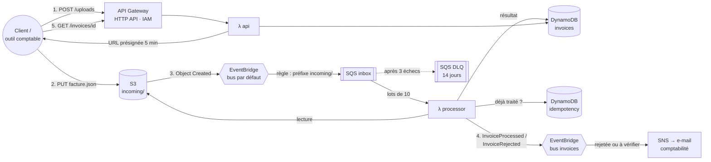
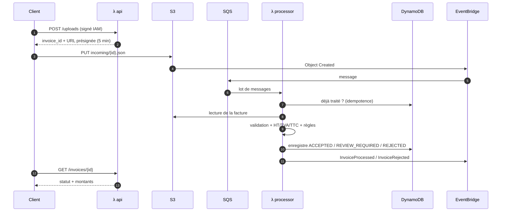

# ⚡ Serverless Event-Driven AWS — traitement de factures fournisseurs

[](https://github.com/Marshall006/serverless-event-driven-aws/actions/workflows/ci.yml)


> Une architecture **serverless et pilotée par les événements** qui reçoit des
> factures fournisseurs, les valide, calcule HT / TVA / TTC, applique des règles
> de conformité et alerte la comptabilité quand une facture exige une
> vérification. **Zéro serveur, zéro coût sans trafic**, résiliente aux pics et
> aux pannes, observable de bout en bout, et documentée comme un architecte le
> ferait : décisions (ADR), revue Well-Architected et estimation de coût.

**Compétences démontrées :** architecture événementielle · serverless (Lambda,
API Gateway, SQS, EventBridge, DynamoDB, S3, SNS) · résilience (DLQ, reprises,
échecs partiels, idempotence) · sécurité (IAM au moindre privilège testé, URL
présignées, API authentifiée) · observabilité (logs structurés, X-Ray,
métriques, alarmes, tableau de bord) · Terraform testé · ADR · AWS
Well-Architected · FinOps.

---

## Sommaire

1. [Le cas d'usage](#-le-cas-dusage)
2. [Architecture](#️-architecture)
3. [Stack technique détaillée](#-stack-technique-détaillée)
4. [Garanties de fonctionnement](#-garanties-de-fonctionnement)
5. [Sécurité](#-sécurité)
6. [Observabilité](#-observabilité)
7. [Décisions d'architecture](#-décisions-darchitecture)
8. [Tests](#-tests)
9. [Démarrage](#-démarrage)
10. [Structure du dépôt](#-structure-du-dépôt)

---

## 🧾 Le cas d'usage

Une PME reçoit chaque mois des centaines de factures (électricité,
télécoms, fournisseurs). Aujourd'hui, quelqu'un les ressaisit et vérifie les
montants à la main. Avec ce système :

1. le fournisseur ou l'outil comptable **dépose la facture** (JSON) ;
2. elle est **validée** : numéro, pays, devise, lignes, montants positifs ;
3. les totaux **HT, TVA (18 % au Bénin) et TTC** sont calculés en arithmétique
   décimale exacte ;
4. une facture d'un **fournisseur non référencé** ou d'un **montant élevé**
   passe en `REVIEW_REQUIRED` et la comptabilité est **alertée par e-mail** ;
5. le résultat est consultable par API, et un événement métier est publié pour
   d'autres systèmes (ERP comme Odoo, archivage, IA…).

## 🏗️ Architecture



### Parcours d'une facture



## 🧰 Stack technique détaillée

| Catégorie | Service / outil | Rôle | Pourquoi ce choix |
|---|---|---|---|
| **Calcul** | **AWS Lambda** (Python 3.13, **arm64**) | Fonctions `api` et `processor` | Aucun serveur, facturation à la milliseconde, Graviton ~20 % moins cher |
| **API** | **API Gateway HTTP API** | 3 routes, authentification IAM, limitation de débit | Moins chère et plus rapide que l'API REST |
| **Stockage fichiers** | **S3** + URL présignées | Dépôt direct des fichiers par le client | Le fichier ne transite pas par la Lambda (limite de 6 Mo évitée) |
| **Événements** | **EventBridge** | Routage S3 → file, et événements métier | Découplage : on ajoute un consommateur sans toucher au reste |
| **File** | **SQS** + **DLQ** | Tampon, lots, reprises, messages en échec | Absorbe les pics, aucune perte |
| **Base** | **DynamoDB** (à la demande) | Résultats + index par statut + idempotence | 0 $ sans trafic, sauvegarde continue |
| **Notifications** | **SNS** | E-mail à la comptabilité et alarmes | Simple, plusieurs abonnés possibles |
| **Observabilité** | **Lambda Powertools**, **X-Ray**, **CloudWatch** | Logs JSON, traces, métriques métier, alarmes, tableau de bord | Standard AWS pour Lambda |
| **IaC** | **Terraform** + `terraform test` | Toute l'infrastructure, 10 tests d'architecture | Même outil que la landing zone (projet 5) |
| **Tests** | **pytest** + **moto** | 19 tests avec S3, SQS, DynamoDB, EventBridge simulés | Tests d'intégration réalistes sans compte AWS |
| **Sécurité IaC** | **Checkov**, **TFLint** | 56 contrôles, exclusions justifiées | Policy-as-code |

## 🛡️ Garanties de fonctionnement

| Situation | Comportement | Test |
|---|---|---|
| Facture valide | `ACCEPTED`, événement `InvoiceProcessed` | `test_valid_invoice_is_stored_and_published` |
| Facture invalide (pays inconnu, montant négatif…) | `REJECTED` + raison, **pas de reprise inutile**, alerte | `test_invalid_invoice_is_rejected_not_retried` |
| Fichier corrompu (non JSON) | `REJECTED` | `test_corrupted_file_is_rejected` |
| Message livré deux fois par SQS | Traité **une seule fois** (idempotence) | `test_duplicate_delivery_is_processed_once` |
| Erreur technique sur 1 message d'un lot de 10 | **Seul ce message** est rejoué | `test_partial_batch_failure_only_retries_the_failing_message` |
| Échec répété (3 fois) | Message en **DLQ**, conservé 14 jours, **alarme** | test Terraform `resilience_retries_then_dead_letter_queue` |
| Pic de 1 000 dépôts | La file absorbe ; concurrence plafonnée à 10 | test Terraform `cost_and_abuse_controls` |

## 🔐 Sécurité

- **Un rôle IAM par fonction**, réduit au strict nécessaire. Un test
  Terraform vérifie qu'aucune action générique (`*`, `s3:*`) n'existe et que
  l'API **ne peut pas écrire** dans la table des factures.
- **API authentifiée par défaut** (signature AWS IAM SigV4) ; mode public
  possible uniquement pour une démonstration.
- **URL présignées** valables 5 minutes, limitées à un fichier précis sous
  `incoming/` : le client n'a jamais d'accès général au bucket.
- S3 **privé**, **TLS obligatoire**, chiffré, versionné ; DynamoDB chiffré
  avec sauvegarde continue ; SQS et SNS chiffrés.
- Seule **la règle EventBridge** peut écrire dans la file (politique SQS avec
  `aws:SourceArn`).
- Validation stricte des entrées : la facture est un **contenu non fiable**.

## 📈 Observabilité

| Signal | Outil | Exemple |
|---|---|---|
| Logs | Powertools Logger (JSON) | `{"level":"WARNING","message":"Facture rejetée","invoice_id":"…","reason":"Pays non pris en charge : US"}` |
| Traces | X-Ray | Durée de chaque étape : S3, DynamoDB, EventBridge |
| Métriques métier | Powertools Metrics (EMF) | `InvoicesAccepted`, `InvoicesReviewRequired`, `InvoicesRejected` |
| Alarmes | CloudWatch → SNS | DLQ non vide, facture en attente > 10 min, erreurs, limitations, 5xx |
| Tableau de bord | CloudWatch | Factures par statut, files, durée p95, erreurs API |

## 📐 Décisions d'architecture

| ADR | Décision |
|---|---|
| [0001](docs/adr/0001-evenements-eventbridge-sqs.md) | S3 → EventBridge → SQS → Lambda plutôt que S3 → Lambda direct |
| [0002](docs/adr/0002-dynamodb.md) | DynamoDB à la demande plutôt qu'une base relationnelle |
| [0003](docs/adr/0003-idempotence.md) | Idempotence du traitement (livraison « au moins une fois ») |
| [0004](docs/adr/0004-graviton-arm64.md) | Lambda sur processeurs ARM (Graviton) |

Revue complète selon les 6 piliers : [**AWS Well-Architected**](docs/well-architected.md),
avec l'estimation de coût.

## ✅ Tests

```bash
make install && make test   # 19 tests Python, AWS simulé par moto
make tf-test                # 10 tests d'architecture Terraform, AWS simulé
make security               # Checkov
```

Aucun compte AWS n'est nécessaire pour tester. La CI exécute aussi tout cela,
construit le paquet Lambda arm64 et vérifie qu'il s'importe dans l'image
Lambda officielle.

## 🚀 Démarrage

**Sur ton compte AWS** (après la landing zone du [projet 5](https://github.com/Marshall006/aws-landing-zone-terraform)) :

```bash
cp infra/backend.hcl.example infra/backend.hcl   # bucket d'état de la landing zone
make deploy                                       # construit le paquet et déploie
pip install awscurl && make demo                  # dépose deux factures, affiche les résultats
make destroy                                      # supprime tout après la démonstration
```

Coût : paiement à l'usage uniquement, sans aucune ressource fixe. Une
démonstration coûte quelques centimes au plus.

## 📁 Structure du dépôt

```
serverless-event-driven-aws/
├── src/invoices/
│   ├── domain.py          # règles métier pures (validation, TVA, conformité)
│   ├── processor.py       # λ SQS -> DynamoDB -> EventBridge (idempotent, lots)
│   └── api.py             # λ API HTTP (URL présignées, consultation)
├── tests/                 # 19 tests (moto : S3, SQS, DynamoDB, EventBridge)
├── infra/                 # Terraform : stockage, messagerie, Lambda, API, alarmes
│   └── tests/             # 10 tests d'architecture (AWS simulé)
├── docs/
│   ├── adr/               # 4 décisions d'architecture
│   └── well-architected.md
├── events/                # factures d'exemple
├── scripts/               # build arm64, démonstration
└── .github/workflows/     # CI + déploiement manuel (OIDC)
```

## 👤 Auteur

**Soumaïla Cissé Piénikoua IDANI** — [GitHub @Marshall006](https://github.com/Marshall006)

Projet 6/6 d'un portfolio **IA / MLOps · Cloud · DevOps** :
[1. MLOps Credit Risk](https://github.com/Marshall006/mlops-credit-risk) ·
[2. RAG Agent](https://github.com/Marshall006/rag-agent-assistant) ·
[3. K8s GitOps Platform](https://github.com/Marshall006/k8s-gitops-platform) ·
[4. DevSecOps Pipeline](https://github.com/Marshall006/devsecops-pipeline) ·
[5. AWS Landing Zone](https://github.com/Marshall006/aws-landing-zone-terraform) ·
**6. Serverless Event-Driven**
